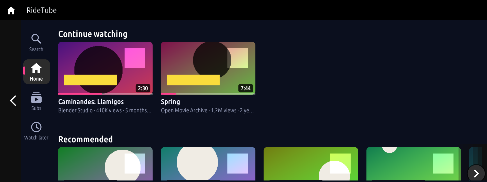
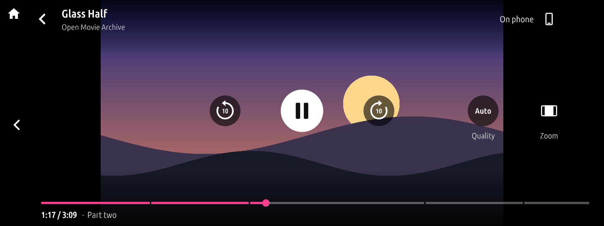
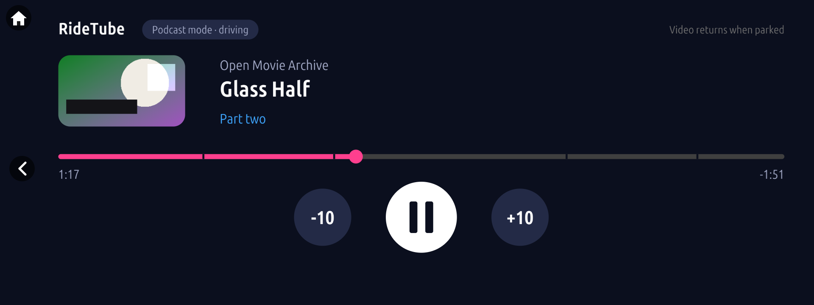
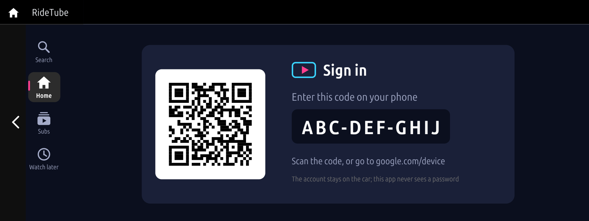

# iDrive8-RideTube (BETA)

RideTube, the unofficial YouTube client for BMW head units, **ported to iDrive 8 (MGU ID8)**. Based on
[JustAnotherPU/ridetube](https://github.com/JustAnotherPU/ridetube) (iDrive 7), GPL-3.0-or-later; the port adds an
iDrive 8 app (`jap_ridetube8`), an iDrive 8-capable service (`jap-ridetube-d` 0.4.1) and Node.js 22 marked for iDrive 8.

> **Beta: runs on an iDrive 8 car, the sound not yet.** On a car, 0.4.4 draws, takes touch, searches and shows
> thumbnails; a video stopped at "Error: audio service timed out" (the service could not bring the car's audio up).
> 0.4.5 with service 0.4.1 looks further for what the sound needs, says why a play fails, and has
> **Settings > Diagnostics**: if a video does not play, photograph its pages. Reports welcome in the issues.

## Install on an iDrive 8 car

1. Root SSH on the head unit and the [MGU Store](https://github.com/robertnisipeanu/mgu-store) installed (its README).
   Back up the head unit's coding before rooting it.
2. The car online through the Store's uplink (`mgu-uplink`: phone hotspot, USB LTE stick or Wi-Fi).
3. In the Store: Settings, **Add source**, type `waliworld/iDrive8-RideTube` and pick **Releases**.
4. Install **RideTube**. The Store installs with it, from this source, its service `jap-ridetube-d` and Node.js 22
   (`jap-node22`); from its own source the renderer `mgu-render`, `mgu-python` and the deploy tool.
5. **Restart the head unit**: on iDrive 8 an app installs at the next start.
6. Open RideTube from All apps. Home shows a code: enter it at google.com/device on your phone to sign in
   (or search without signing in).

Uninstall: in RideTube's Settings (left rail), Sign out; then uninstall RideTube and its service in the Store.

## Releasing (maintainers)

```sh
MGU_STORE=<a clone of github.com/robertnisipeanu/mgu-store> tools/release_id8.sh   # -> dist/release/
```

Upload every file of `dist/release/` to the GitHub release tagged `catalog` (the Store reads its `catalog.json`).
The script builds the app and packs the service and Node.js 22 from this repository; the prebuilt binaries (the video
decoder `ytdec`, yt-dlp 2026.10.26 and the Node.js 22 build) are taken from JustAnotherPU's published releases and
checked against sha256 sums pinned in the script.

## Licence

GPL-3.0-or-later, as RideTube ([LICENSE](LICENSE), copyright JustAnotherPU and contributors). The app kit (`kit/`) and
the Node.js 22 tool (`tools/jap-node22/`) are MIT ([kit/LICENSE](kit/LICENSE),
[tools/jap-node22/LICENSE.mgu-apps](tools/jap-node22/LICENSE.mgu-apps)); third-party parts as in
[THIRD_PARTY_LICENSES](THIRD_PARTY_LICENSES).

---

# RideTube

> **Experimental and unofficial.** RideTube is an unofficial client for YouTube. It is not affiliated with,
> endorsed by or sponsored by Google or YouTube. Use it at your own risk. You are responsible for following
> YouTube's Terms of Service and the laws of your country, and for using it safely: by default the picture
> shows only while the car is parked.

| | |
|---|---|
|  |  |
| Home: your shelves, Continue watching first | The player, with chapters on the progress bar |
|  |  |
| While driving: the sound plays on, no picture | Sign in with a code on your phone |

Rendered on a computer with demo data (Blender open movie titles), not photographed in a car.

RideTube plays videos on the BMW iDrive 7 and iDrive 8 head units (MGU), installed from the MGU Store. Everything
runs on the car, over the car's own internet connection:

- **Home**, **Subscriptions** and **Watch later**, once you sign in on the car with the TV device sign-in (a
  code to enter on your phone; RideTube never sees your password).
- Search, channel pages, chapters, the video quality and fill or fit for the picture.
- Skip segments from [SponsorBlock](https://sponsor.ajay.app) (sponsors, self-promotion, intros and similar).
- The sound plays through the car's own media player.
- While driving, the picture is replaced by a podcast view (title, progress, controls) and the sound plays on.
  The picture comes back when the car is parked again.
- Nothing is stored for later. The video playing is downloaded to the head unit in full while it plays, then
  deleted: expect the video's whole size on your data plan, even if you stop early. The download stops if the
  head unit's storage gets low.
- Signed in, what you watch goes to your YouTube history, as on a TV.

## Requirements

- A BMW with iDrive 7 (MGU, `ID7`) or iDrive 8 (`ID8`, see "iDrive 8" below) and the
  [MGU Store](https://github.com/robertnisipeanu/mgu-store) installed.
- The car online through the Store's uplink (`mgu-uplink`).
- Installed for you as requirements, so keep their sources in the Store: from the Store's own source, the
  renderer `mgu-render` 0.6.11 or newer, `mgu-deploy` 0.7.0 and `mgu-python` 1.0.2; on iDrive 7, from the Store's
  default `cauliflowermossgrape/idrive7-apps` source, the controller gate `mgu-inputgate` 1.0.0.

## Install

In the MGU Store, add the source

```
JustAnotherPU/ridetube:releases
```

Add `JustAnotherPU/mgu-apps:releases` too (it is a default source once accepted): it has `jap-node22`, the
Node.js 22 that RideTube's service runs on (yt-dlp needs it). Without that source the install stops with
"needs jap-node22". Then install RideTube: the Store lists the one for your head unit, **RideTube** (`jap_ridetube`,
iDrive 7) or **RideTube** (`jap_ridetube8`, iDrive 8), and installs its service (`jap-ridetube-d`, the player, the
yt-dlp fetcher and the video decoder) and, from mgu-apps, `jap-node22` with it. On iDrive 8, apps install at the
next head-unit restart.

## iDrive 8

Beta: built and tested on a computer against iDrive 8's screen (2880 x 960); on a car the app, its screen, touch,
search and thumbnails work (0.4.4), **the sound and the picture of a video are not confirmed yet**. Reports welcome
in the issues.

- Its own app, `jap_ridetube8`, from the same code: the HMI has a page of the app's (status lines only) and the GPU
  renderer draws the whole screen over the app area (under the HMI's status strip, over the climate bar). Five tiles
  a row.
- **A source package.** On iDrive 8 the MGU Store's deploy tool gives BMW's oap-sdk only to source packages
  (`mgu-app.json`): it links the modules they list against the SDK of an app already on the car, as it builds the
  Store's own app. (On iDrive 7 it also generates `node_modules/oap-sdk` for an ordinary package; on iDrive 8 such a
  package installs, shows its tile and never starts.) `build.py --hmi ID8` writes `dist/src/jap_ridetube8@<v>.tgz`:
  `mgu-app.json`, one linked module (`kit/id8/boot.js`: the start, the tile, the shutdown) and the package tree with
  the kit and the app as plain files (`app/`). The linked module gives them the SDK through `kit/sdk.js`, not a
  global: on the car the bundle's `global` is its own.
- **The renderer.** The kit connects to mgu-render as the iDrive 8 apps known to draw on a car do (IterioDev's
  dialect: a layer over the app area, touch claims, pictures, videos), not with mgu-render/1, whose foreground gate
  is unconfirmed on iDrive 8.
- Touch only (no controller gate on iDrive 8). The header's back arrow closes RideTube (a sheet over the page first).
- Search opens RideTube's own keyboard, with your recent searches as buttons. Typing works only while parked; the
  recent searches work while driving.
- The rail's **Settings** has the account (Sign in, Sign out pressed twice), **Diagnostics** and the settings.
- The video is decoded as a 16:9 frame as tall as the app area (1358 x 764).
- Needs `jap-node22` with iDrive 8 in its catalog: this repository's release has it (JustAnotherPU/mgu-apps lists it
  for iDrive 7 only, so its source alone stops the install with "needs jap-node22").

What may need a fix on the car, and how to tell (`journalctl -u jap-ridetube-d`, the app's
`/var/opt/public/oap/oap_<uid>/data/jap_ridetube8.log`):

- **The sound.** The service plays through BMW's media player as on iDrive 7 (the audio manager's CommandControl,
  the MediaPlayer instance `OapGenericMedia`, source 1046, sink 1024), and looks further where an iDrive 8 keeps
  them elsewhere (`native/jap-ridetube-d/README.md`). If a video ends with "Error: the car's audio is not ready
  ..." or does not sound, open **Settings > Diagnostics** and photograph every page (Next): they say where the
  start stopped, what the car has and what it answered. A route known to be right goes in
  `/var/opt/jap-ridetube-d/state/audio.json`, then restart the service.
- **The picture.** ytdec decodes on the Intel GPU with the head unit's Media SDK (`libmfxhw64`). The service logs at
  start whether the head unit has it. Without it the sound plays and the picture shows "video failed, audio only".
- **The tile.** The entry module makes the tile usable as the MGU Store's app does on iDrive 8 (the name and icon
  stay the manager's). If the tile greys out or does nothing, the app's log has its lines (`boot: ...`): whether the
  SDK started, the start reason, the tile's steps, the page. No `boot:` line at all means the app's process did not
  get as far as its first line. If the install itself is refused, the Store says why (the head unit could not build
  the package).
- **A grey page.** The HMI's own page under RideTube's screen has four status lines and says the reason in its
  title: the version, how the app was started, the tile, the page and whether the app's code loaded
  (`start: ... | tile: ... | page: ... | app: ...`), the screen (`visible`, `focus`, `stack`), the renderer
  (`connected`, the dialect, `touch`, `asked`, `claims`, `frames`, `ticks`) and the service. RideTube's screen covers them while it draws, so
  a page you can read them on is one the picture did not reach: a photo of it is the report. A page with only
  `Starting...` means the app's process did not run. The app's log has the first events the HMI sent
  (`hmi: visible ...`, `hmi: focus ...`, `hmi: stack ...`).

## Settings

- **Video while driving**: off by default. Leave it off unless the car is coded for video in motion and only
  passengers can see the screen. You use it at your own risk. It takes effect only once switched on while the
  car is parked: pressed while driving, the picture stays off until the next stop.
- **Fill the screen**: off by default (black bars); on, the picture is cropped to fill the screen.
- **Video quality**: auto (720p on Wi-Fi, 480p on phone data), 720p, 480p or 360p.
- **Show members-only videos**: off by default. A channel can also be hidden from its page.
- **SponsorBlock**, per category: skip, show a Skip button, or off.
- **Parked: pause when the 12 V battery is under** 60, 65 (default) or 70 %, or never.
- **Sign in** / **Sign out** in the app's menu.

The parked check reads the car's speed. A reading older than 5 seconds counts as driving.

## Tested on

| | |
|---|---|
| Car | BMW X5 xDrive45e (G05), iDrive 7 (MGU, ID7 HMI), firmware P18_23w44.2-1-3 |
| iDrive 8 | not yet on a car: the computer tests (`kit/tools/test_ridetube8.js`) only |
| Internet | the Store's uplink over home Wi-Fi and an iPhone hotspot |

One car only so far. Reports from other cars are welcome in the issues.

## Known limits

- yt-dlp breaks now and then when YouTube changes. A fixed RideTube release then needs a new yt-dlp (see
  `native/jap-ridetube-d/README.md`, "Updating yt-dlp").
- H.264 only (up to 720p, 30 fps preferred), decoded on the head unit's GPU. A video with no H.264 stream
  does not play.
- Signing in uses the TV device sign-in that YouTube's TV apps use. The client id is read from YouTube's TV
  page when you sign in; RideTube ships none.
- The switch from the first seconds of sound to the full file may be heard as a short break.
- Any app installed on the head unit can drive RideTube's service through its control socket (it is open to the
  group every app shares). Install only apps you trust; see `native/jap-ridetube-d/README.md`, "Security notes".

## Uninstall

1. In RideTube, **Sign out** (or later, remove "YouTube on TV" at https://myaccount.google.com/permissions):
   uninstalling deletes the sign-in from the car, but Google keeps the grant until it is revoked.
2. In the MGU Store, uninstall **RideTube**, then its service `jap-ridetube-d`. A bad update can be undone in the
   Store while the previous version is kept.

## Layout

| Path | |
|---|---|
| `apps/jap_ridetube` | the app (Node 8, the iDrive's own app runtime), for iDrive 7 and, built with `--hmi ID8`, iDrive 8 |
| `kit/` | the idrive7-apps app kit, trimmed to the modules RideTube uses, with an iDrive 8 profile (`display.js`, `keyboard.js`) |
| `native/jap-ridetube-d` | the service on the car: player, fetcher, account, search, thumbnails |
| `native/ytdec` | the H.264 decoder that draws into the renderer's video layer |
| `tools/release.py` | lays out the Store catalog (`catalog.json` and its assets) |

## Build and test on a computer

```sh
node kit/tools/test_runtime.js && node kit/tools/test_life.js && node kit/tools/test_parked.js \
  && node kit/tools/test_qr.js && node kit/tools/test_keyboard.js
(cd native/jap-ridetube-d && node test/test_ytd.js && node test/test_thumb.js && python3.12 -I test/test_ytfetch.py)
(cd native/ytdec && make test && make target)     # make target needs Docker
```

A release needs an `oap-sdk` folder extracted from a BMW app you own (`node kit/tools/extract_sdk.js
<javascript/app.js of a BMW app>`; never commit it), then:

```sh
python3 kit/tools/build.py jap_ridetube && node kit/tools/test_ridetube.js
python3 kit/tools/build.py --hmi ID8 jap_ridetube && node kit/tools/test_ridetube8.js   # SHOTS=<dir>: PNGs of each screen
MGU_STORE=<a clone of github.com/robertnisipeanu/mgu-store> node kit/tools/test_mgu8.js   # iDrive 8: built by the Store's linker, started
node kit/tools/test_node8.js                                                             # every shipped file parses as Node 8 does
export MGU_STORE=<a clone of the MGU Store>
(cd native/jap-ridetube-d && ./build.sh)      # jap-node22 is built in github.com/JustAnotherPU/mgu-apps
python3 tools/release.py      # dist/release/: upload every file to a GitHub release tagged "catalog"
```

The tests need Node 18 or newer, Python 3.12 and ffmpeg.

## License

GPL-3.0-or-later, Copyright (c) 2026 JustAnotherPU ([LICENSE](LICENSE)). Parts come from others under their
own licences (the app kit: MIT; parts of `native/ytdec`: GPL-3.0-or-later; yt-dlp: Unlicense, fetched at
build time; SponsorBlock data: CC BY-NC-SA 4.0): see [THIRD_PARTY_LICENSES](THIRD_PARTY_LICENSES).
